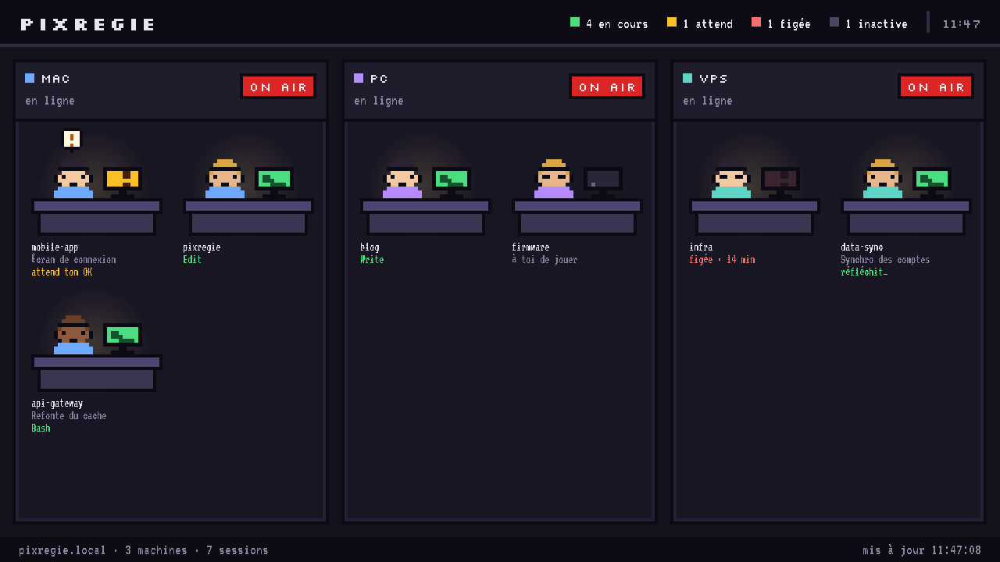

# Pixregie

**A pixel-art control room for your Claude Code sessions.**

Pixregie turns a Raspberry Pi and a spare screen into a passive status board.
Every Claude Code session running on your machines shows up as an operator at
a desk, and the desk's screen tells you at a glance whether the session is
working, waiting for you, finished or stuck.



It only watches. It never sends prompts, approves tools or touches your
Claude account, and it consumes no tokens.

## How it works

```
 Mac / Windows                                  Raspberry Pi
 ┌──────────────────────────┐    LAN, HTTP     ┌──────────────────────────┐
 │ Pixregie (menu-bar app)  │ ───────────────▶ │ pixregie-display         │
 │  reads ~/.claude/projects│  every 3 s       │  collector + screen      │
 │  + 3 Claude Code hooks   │                  │  + debug page            │
 └──────────────────────────┘                  └──────────────────────────┘
```

- The agent reads Claude Code's local session files and keeps **metadata
  only**: project folder name, git branch, session title, current tool name,
  status and timestamps.
- Prompts, commands, tool output and file contents **never leave the
  machine**. The session title is the one exception derived from the
  conversation (it is the name Claude Code shows for the session); it only
  travels to the Pi on your local network.
- Three Claude Code hooks tell the agent when a session opens, closes, or
  waits for a permission. They only carry the session id.
- The Pi finds nothing by itself: agents find the Pi with mDNS
  (`_pixregie._tcp`) and push to it with a per-machine token.

## Statuses

| On the screen                 | Meaning                                         |
|-------------------------------|-------------------------------------------------|
| green screen, scrolling lines | Claude is writing or a tool is running          |
| amber screen + `!` bubble     | Claude Code waits for your permission           |
| blinking red screen           | was working, nothing moved for 10 minutes       |
| dark screen, eyes closed      | the turn is over: your move                     |

A room's **ON AIR** light is on while any of its sessions works. Closed
sessions disappear; idle sessions not known to be open are hidden after an
hour. Lamps turn on at night (19:00 to 07:00).

## Install

You need a Raspberry Pi (3B or newer) on the same network as your machines,
a screen on its HDMI port, and Claude Code on the machines to watch.

### 1. The Raspberry Pi

Flash **Raspberry Pi OS Lite (64-bit)**, enable SSH, then on the Pi:

```sh
curl -fsSLO https://github.com/dmckminard/pixregie/releases/latest/download/install-pi.sh
sudo bash install-pi.sh
sudo reboot
```

The script asks for a password for the debug page, then installs a
hardened systemd service, announces the board on the network, hides the
text console and turns on automatic security updates. The picture adapts
to the screen: native 1080p, 720p, and pixel-perfect upscales for 1440p
and 4K.

### 2. macOS

```sh
curl -fsSL https://raw.githubusercontent.com/dmckminard/pixregie/main/install/mac/install.sh | bash
```

The script downloads the latest `Pixregie.app`, checks its SHA-256 against
the release, installs it in Applications and starts it. The app is not
notarised yet; installed this way macOS does not block it. (Downloading the
zip with a browser works too, but macOS then asks you to allow it in
System Settings › Privacy & Security.)

On first launch, allow **local network access** when macOS asks.

### 3. Windows

Download [`Pixregie.exe`](https://github.com/dmckminard/pixregie/releases/latest/download/Pixregie.exe),
put it where you like and run it. SmartScreen warns about an unknown
publisher: *More info › Run anyway*.

### 4. Pair each machine

On first launch the app finds the Pi, and **the Pi's screen shows a
six-digit code**. Type it in the app's window: done. The code expires after
2 minutes and three wrong tries cancel it.

The app then stores its token in the Keychain (macOS) or encrypted with
DPAPI (Windows), installs its Claude Code hooks, and turns on **launch at
login**.

If the Pi cannot be found (another network, mDNS blocked), the app offers
to paste a token instead. Create one on the Pi with
`sudo bash install-pi.sh --add-agent NAME`.

### Linux machines (headless)

```sh
curl -fsSLo pixregie-agent https://github.com/dmckminard/pixregie/releases/latest/download/pixregie-agent-linux-amd64
chmod +x pixregie-agent
./pixregie-agent pair          # type the code shown on the Pi
./pixregie-agent hooks install
./pixregie-agent run
```

## Everyday use

The menu-bar (macOS) or tray (Windows) icon shows the most urgent state.
Its menu:

| Item                     | What it does                                          |
|--------------------------|-------------------------------------------------------|
| status line              | connected to the Pi, or what is wrong                 |
| counters                 | working, waiting and stuck sessions on this machine   |
| Rafraîchir               | rescan sessions now and look for the Pi again         |
| Ouvrir la page de debug  | the Pi's page: live picture of the screen and data    |
| Lancer au démarrage      | launch at login; your choice is remembered            |
| Associer à nouveau…      | pair again (new Pi, or after a reset)                 |
| Quitter Pixregie         | quit                                                  |

Only one copy of the app runs at a time.

## Update

- **Pi**: run the two `curl` / `sudo bash install-pi.sh` lines again. The
  configuration (password, paired machines) is kept.
- **macOS**: run the install command again.
- **Windows**: quit Pixregie, replace `Pixregie.exe`, start it again.

Pairing is kept across updates.

## Uninstall

- **Pi**: `sudo bash install-pi.sh --uninstall` (keeps `/etc/pixregie`;
  delete it to forget passwords and paired machines).
- **macOS**:
  ```sh
  /Applications/Pixregie.app/Contents/MacOS/pixregie-agent hooks uninstall
  rm -f ~/Library/LaunchAgents/fr.pixregie.agent.plist
  rm -rf /Applications/Pixregie.app "$HOME/Library/Application Support/Pixregie"
  security delete-generic-password -s fr.pixregie.agent
  ```
- **Windows**: untick *Lancer au démarrage*, run
  `Pixregie.exe hooks uninstall`, then delete `Pixregie.exe` and
  `%AppData%\Pixregie`.

`hooks uninstall` removes only Pixregie's entries from
`~/.claude/settings.json`; the original file was saved once as
`settings.json.pixregie-backup`.

## Troubleshooting

| Symptom                                  | Fix                                                                 |
|------------------------------------------|---------------------------------------------------------------------|
| “Pi introuvable sur le réseau”           | Same network? On macOS, allow local network access (System Settings › Privacy & Security › Local Network). Otherwise pair with a token. |
| “Le Pi doit être mis à jour”             | Update the Pi (see *Update*).                                       |
| “Token refusé par le Pi”                 | *Associer à nouveau…*                                               |
| A closed session stays on the screen     | It was opened before the hooks were installed: it disappears after an hour idle. |
| Black borders on the Pi's screen         | Reboot once after installing.                                       |

The debug page (`http://<pi-address>:7421`, any user name and your
password) shows the live screen and what each machine reports.

## Security

- The agent's only network traffic is to the Pi; its hook endpoint listens
  on `127.0.0.1` and refuses browser requests.
- Tokens are random (256 bits), stored hashed on the Pi; the debug password
  is stored with PBKDF2. A leaked Pi configuration reveals no secret.
- The Pi takes a machine's name from its token, so one machine cannot
  report as another. Reports are size-limited and sanitised.
- The display service runs as a dedicated user under systemd sandboxing
  (no capabilities, read-only system, access to the framebuffer only).

## Development

Go 1.24+.

```sh
go test ./...
go run ./cmd/pixregie-agent scan                          # what the agent sees
go run ./cmd/pixregie-display render -scale 1.5 -o out.png # the screen, demo data
```

- `cmd/pixregie-agent`: menu-bar app (macOS, Windows) and CLI.
- `cmd/pixregie-display`: the Pi service.
- `internal/session`: session file parser; `internal/hooks`: Claude Code
  hooks; `internal/screen`: the pixel-art renderer; `internal/collector`:
  the Pi's API and pairing.
- Fonts (Silkscreen, VT323, OFL) are pre-rasterised by `tools/fontgen`.

Releases are built by GitHub Actions: bumping `VERSION` on `main` publishes
`v<VERSION>` with every binary and `SHA256SUMS`.

## License

MIT. Pixregie is an independent project, not affiliated with Anthropic.
"Claude" and "Claude Code" are trademarks of Anthropic.
